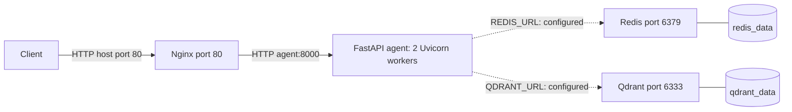

# Mission Answers

## Part 1 — Localhost vs Production (CP1)

### Exercise 1.1 — Anti-patterns

Đường dẫn trong bảng tính từ `01-localhost-vs-production/`. Số dòng đã đối chiếu trực tiếp với source bằng `nl -ba`.

| Dòng code develop | Lỗi và tác động | Code production | Sửa trong production           |
| --- | --- | --- | --- |
| `develop/app.py:17–18`: `OPENAI_API_KEY`, `DATABASE_URL` hardcode | Credential nằm trong source và có thể lộ qua lịch sử Git. Các credential mẫu là giả. | `production/config.py:27,32`; `production/app.py:24` | Đọc provider key và agent key bằng `os.getenv`, sử dụng `settings`. `DATABASE_URL` hardcode đã bị loại bỏ; bản mẫu chưa có cấu hình/kết nối database thay thế. |
| `develop/app.py:21–22`: `DEBUG=True`, `MAX_TOKENS=500` | Đổi cấu hình phải sửa source. | `production/config.py:19,29` | Đọc `DEBUG`/`MAX_TOKENS` từ môi trường, chuyển sang bool/int và có default. `MAX_TOKENS` mới nằm ở config, mock LLM chưa dùng nó để giới hạn đầu ra. |
| `develop/app.py:33,38`: `print(...)` | Log thiếu level và cấu trúc nhất quán. | `production/app.py:28–32,111–122` | Dùng `logging` và event qua `json.dumps`, ghi độ dài request/response. Formatter mẫu vẫn chưa bảo đảm mọi dòng là JSON hợp lệ. |
| `develop/app.py:34`: in `OPENAI_API_KEY` | Secret lộ cho người đọc log. | `production/app.py:111–115,119–122` | Log event, độ dài câu hỏi/câu trả lời và IP thay vì log key. |
| `develop/app.py:25–39`: chỉ có `/` và `/ask`; dòng 42 xác nhận thiếu health | Thiếu endpoint riêng cho liveness/readiness. | `production/app.py:135–149,152–161` | Thêm `/health` trả status/uptime/version và `/ready` trả 503 khi `is_ready=False`. Readiness mẫu chưa probe Redis/DB. |
| `develop/app.py:51`: `host="localhost"` | Không nhận traffic từ ngoài container. | `production/config.py:17`; `production/app.py:196` | Host lấy từ `HOST`, default `0.0.0.0`, được truyền vào `uvicorn.run`. |
| `develop/app.py:52`: `port=8000` | Không dùng port do cloud cấp. | `production/config.py:18`; `production/app.py:197` | Chuyển `PORT` từ env thành int rồi truyền vào Uvicorn; mặc định 8000 khi env không đặt. |
| `develop/app.py:53`: `reload=True` | Bật development reloader trong production. | `production/config.py:19`; `production/app.py:195,198` | Reload theo `settings.debug`, default false; chỉ dùng import string để reload khi debug bật. |
| `develop/app.py:13,49–54`: tạo `FastAPI` không có lifespan và chạy Uvicorn, không đăng ký cleanup riêng | Chưa có lifecycle hook để dọn tài nguyên ứng dụng. Uvicorn vẫn có xử lý signal mặc định. | `production/app.py:39–67,70–74` | Thêm async-context-manager `lifespan`, startup đặt `is_ready=True`, shutdown đặt false và log cleanup. Việc chờ request hoàn tất do Uvicorn đảm nhiệm; sleep trong hook không tự bảo đảm graceful shutdown. |

### Exercise 1.2 — Chạy develop và gọi API thật

Dùng interpreter đã có FastAPI/Uvicorn trong `.venv` của Part 6 (cùng phiên bản dependency), không sửa code mẫu. Chạy ở cổng riêng 18101 để tránh ảnh hưởng server khác; CLI override host/port nên nhận xét host/port hardcode ở trên dựa trên source, không phải phép thử cấu hình mặc định `python app.py`.

Từ gốc repo:

```bash
cd 01-localhost-vs-production/develop
../../06-lab-complete/.venv/bin/python -m uvicorn app:app --host 127.0.0.1 --port 18101
```

Request đã được tự động gửi qua HTTP bằng Python urllib, tương đương:

```bash
curl -i -X POST 'http://127.0.0.1:18101/ask?question=Hello'
```

Kết quả thực tế: **HTTP 200**.

```json
{
  "answer": "Đây là câu trả lời từ AI agent (mock). Trong production, đây sẽ là response từ OpenAI/Anthropic."
}
```

Thử `POST /ask` với JSON `{"question":"Hello"}` → **422**, báo thiếu `query.question`. `GET /health` → **404**. Bản develop dùng query parameter, đúng lưu ý K5 trong README.

### Exercise 1.3 — So sánh develop / production

| Feature | Develop | Production mẫu | Tại sao quan trọng? |
| --- | --- | --- | --- |
| Config | Giá trị cố định trong source | `config.py` đọc `os.getenv`, chuyển kiểu port/debug | Thay cấu hình theo môi trường mà không đổi code. |
| Secrets | Hardcode và in key ra log | Đọc env, không in key trong request log | Giảm nguy cơ lộ credential trong repo và logs. |
| Health check | Không có endpoint | `/health` trả status, uptime, version | Cho nền tảng kiểm tra process còn phục vụ được. |
| Readiness | Không có endpoint | `/ready` kiểm tra cờ `is_ready` | Tách trạng thái đã startup khỏi trạng thái process sống; bản mẫu chưa kiểm tra DB/Redis. |
| Logging | `print` câu hỏi/key/response | Dùng logging và event có cấu trúc | Dễ tìm kiếm sự kiện, nhưng implementation mẫu còn hạn chế (xem dưới). |
| Shutdown | Không có cleanup riêng | `lifespan` có startup/shutdown, đặt lại readiness | Có nơi giải phóng tài nguyên sau khi server xử lý xong request đang chạy. |
| Network | `localhost:8000` | Host mặc định `0.0.0.0`, port lấy từ env | Container nhận traffic bên ngoài và dùng port cloud cấp. |
| Reload | Luôn `True` | Theo `DEBUG`, mặc định `false` | Tránh chạy development reloader trong production. |
| Input | `question` query parameter | JSON body và kiểm tra question không rỗng | Có hợp đồng request rõ ràng; invalid input trả 422. |

Lệnh chạy production đã kiểm tra, từ thư mục `production/`:

```bash
PORT=18102 DEBUG=false ENVIRONMENT=development ../../06-lab-complete/.venv/bin/python app.py
```

Không cần provider key vì dùng mock LLM. `config.py` đọc môi trường process; bản mẫu không tự gọi `load_dotenv`, nên chỉ copy `.env.example` sang `.env` chưa đủ để nạp file đó.

| Phép thử HTTP thật | Status | Kết quả |
| --- | ---: | --- |
| `POST /ask`, JSON `{"question":"Hello"}` | 200 | Có `question`, `answer`, `model` |
| `POST /ask`, JSON `{"question":""}` | 422 | `question field is required` |
| `GET /health` | 200 | `status=ok`, version `1.0.0`, environment `development` |
| `GET /ready` | 200 | `{"ready":true}` |

Giới hạn của bản production mẫu: formatter chèn message vào JSON string mà không escape nội dung; ngoài ra config có thể gọi logging trước `basicConfig`, nên không bảo đảm log JSON hợp lệ. `/ready` chỉ dựa vào cờ startup, chưa probe dependency. `/metrics` trả JSON thông thường, chưa phải exposition format của Prometheus. Khóa API được đọc vào config nhưng chưa được enforce trên `/ask`. Vì vậy đây là ví dụ để so sánh, chưa phải ứng dụng production hoàn chỉnh.

### Những điểm cần giải thích

- Secret hardcode có thể tồn tại trong lịch sử Git ngay cả sau khi xóa dòng đó; dùng env và không log secret.
- Health/liveness cho biết process phục vụ được; readiness cho biết có thể nhận traffic, gồm tình trạng dependency khi triển khai thật.
- Graceful shutdown: ngừng nhận request mới, cho request đang xử lý hoàn tất rồi đóng tài nguyên và thoát.
- Env tách cấu hình khỏi source; secret trên Render đặt trong Environment, không commit `.env`.

Các tiến trình thử nghiệm đã được dừng sau khi thu kết quả. CP1 đã được AI thực thi và soạn báo cáo; sinh viên cần tự đọc lại, giải thích và kiểm tra độc lập.

## Part 2 — Docker (CP2)

### Exercise 2.1 — Bốn câu hỏi Dockerfile

Đường dẫn bên dưới tính từ `02-docker/`.

1. **Base image:** `develop/Dockerfile:8` dùng Python 3.11 bản đầy đủ. Khi thực thi, đổi registry sang `public.ecr.aws/docker/library/python:3.11` để tránh giới hạn tải Docker Hub đã gặp ở Part 6. Production dùng biến thể `3.11-slim` ở dòng 16 và 36.
2. **Working directory:** `develop/Dockerfile:11` là `WORKDIR /app`. Các lệnh RUN, đích COPY tương đối và lệnh khởi động sau đó chạy từ `/app`.
3. **COPY requirements trước:** dòng 14 copy dependency manifest, dòng 17 cài dependency, dòng 20 mới copy app. Khi chỉ đổi code app, Docker có thể dùng lại layer cài package nếu requirements/base/những input trước đó không đổi. `pip --no-cache-dir` chỉ tắt cache pip, không tắt Docker layer cache.
4. **CMD và ENTRYPOINT:** ENTRYPOINT xác định executable chính của container; CMD cung cấp lệnh mặc định khi không có ENTRYPOINT, hoặc đối số mặc định khi có ENTRYPOINT. Đối số sau tên image trong `docker run` thay CMD; `--entrypoint` thay ENTRYPOINT. Ví dụ `docker run --rm my-agent:develop python --version` thay CMD `python app.py` ở dòng 30. Exec form (JSON array) tránh shell trung gian khi không cần shell expansion.

### Exercise 2.2 — Build và chạy develop

Build context là **gốc repo**, vì các lệnh COPY dùng đường dẫn `02-docker/...` và `utils/...`:

```bash
docker build -f 02-docker/develop/Dockerfile -t my-agent:develop .
docker run --rm -p 8000:8000 my-agent:develop
```

Phép thử tự động thực tế dùng `docker run -d -p 127.0.0.1::8000` để Docker cấp cổng host trống, sau đó lấy cổng bằng `docker port`. Tương đương khi dùng cổng 8000:

```bash
curl -i http://127.0.0.1:8000/health
curl -i -X POST 'http://127.0.0.1:8000/ask?question=What%20is%20Docker%3F'
```

Kết quả: `/health` **200**, `/ask` qua query **200**. Response `/ask` thực tế:

```json
{
  "answer": "Container là cách đóng gói app để chạy ở mọi nơi. Build once, run anywhere!"
}
```

Gửi JSON thay cho query là phép thử âm: **422**, thiếu `query.question`. `docker exec <container> id` trả `uid=0(root) gid=0(root) groups=0(root)`.

### Exercise 2.3 — Multi-stage và dung lượng image

- **Builder:** `production/Dockerfile:16–29` dùng Python slim, cài `gcc`, `libpq-dev` và dependency Python vào `/root/.local` bằng `pip --user`.
- **Runtime:** dòng 36 tạo stage mới từ slim; dòng 45 chỉ copy installed packages, dòng 48/52 copy app và mock utils; dòng 58 dùng `appuser`; dòng 68–69 khai báo HEALTHCHECK.
- Build tools của builder không được copy sang runtime. Base slim cũng nhỏ hơn base Python đầy đủ. So sánh này thay đổi cả base image và cách chia stage, nên không thể quy toàn bộ mức giảm cho multi-stage.
- Image runtime vẫn có công cụ đi kèm Python base (bao gồm pip); không thể kết luận multi-stage tự loại bỏ mọi build/package tool.

```bash
docker build -f 02-docker/production/Dockerfile -t my-agent:advanced .
docker images my-agent
docker image inspect my-agent:develop --format '{{.Size}}'
docker image inspect my-agent:advanced --format '{{.Size}}'
```

Số đo thực tế từ `docker image inspect`, đơn vị MB thập phân (`bytes / 1,000,000`), không phải kích thước download nén:

| Image | Bytes | MB | User |
| --- | ---: | ---: | --- |
| `my-agent:develop` | 1,667,783,932 | 1,667.78 | root (default) |
| `my-agent:advanced` | 239,823,320 | 239.82 | appuser |

Mức giảm: `(1,667,783,932 - 239,823,320) / 1,667,783,932 × 100 = 85.62%`.

Container production độc lập: `/health` **200**, JSON `POST /ask` **200**. `docker exec <container> id` trả `uid=999(appuser) gid=999(appuser) groups=999(appuser)`.

HEALTHCHECK đánh dấu healthy/unhealthy; Docker standalone không tự restart container chỉ vì unhealthy. Restart policy tác động khi process/container thoát, hoặc cần nền tảng giám sát có logic khởi động lại.

### Exercise 2.4 — Docker Compose stack

Đã tạo `.env.local` rỗng trong `02-docker/production/` theo lưu ý K5; file được Git ignore. Lệnh chạy thực tế từ gốc repo:

```bash
docker compose -p k5-day14-docker -f 02-docker/production/docker-compose.yml up -d --build --wait --wait-timeout 120
```



Tất cả service dùng network bridge `internal`, tìm nhau bằng DNS service name. Redis và Qdrant có healthcheck; agent đợi cả hai healthy trước khi start. Nginx proxy request đến `agent:8000`; agent không publish cổng trực tiếp ra host. `depends_on` kiểm soát thứ tự khởi động, không tự phục hồi dependency chết về sau.

Có **một container agent**, bên trong có hai Uvicorn workers theo Dockerfile; không phải hai replica. Redis/Qdrant được provision và khai báo URL nhưng `production/main.py` hiện chỉ gọi mock LLM, chưa thực hiện cache/session/RAG. Mũi tên nét đứt biểu thị cấu hình dự kiến, không khẳng định có traffic Redis/Qdrant từ agent.

| Service | State quan sát được | Health |
| --- | --- | --- |
| agent | running | healthy |
| redis | running | healthy |
| qdrant | running | healthy |
| nginx | running | Không khai báo healthcheck |

Request HTTP thực tế đã gửi bằng Python urllib, tương đương:

```bash
curl -i http://127.0.0.1/health
curl -i -X POST http://127.0.0.1/ask \
  -H 'Content-Type: application/json' \
  -d '{"question":"Explain microservices"}'
```

Qua Nginx: `/health` **200** (`version=2.0.0`), JSON `/ask` **200**. Response `/ask` thu được:

```json
{
  "answer": "Tôi là AI agent được deploy lên cloud. Câu hỏi của bạn đã được nhận."
}
```

Nginx có rate limit theo IP (10 request/giây, burst 20) ở route chung; `/health` có location riêng. Compose publish thêm 443 nhưng nginx.conf chỉ listen 80, nên không khẳng định HTTPS hoạt động.

Cảnh báo Compose: `version: "3.9"` đã obsolete và được bỏ qua; không ảnh hưởng kết quả. Sau khi thu số đo, đã dừng/xóa chỉ stack CP2 và volume thử nghiệm:

```bash
docker compose -p k5-day14-docker -f 02-docker/production/docker-compose.yml down -v
```

Bằng chứng máy đọc được: `reports/cp2-docker.json`. CP2 đã hoàn thành phần thực thi và báo cáo; chờ sinh viên kiểm tra và duyệt trước CP3.

## Part 4 — API Security (CP3)

K5 đặt Part 4 ở CP3; Part 3 deploy thực hiện ở CP6. Chạy các ví dụ có sẵn, không viết lại source. Production dùng virtualenv riêng `04-api-gateway/production/.venv` vì requirements yêu cầu Pydantic >=2.11, khác pin 2.9.0 của Part 6. Phiên bản thực tế:

```json
{
  "fastapi": "0.165.0",
  "pydantic": "2.14.4",
  "pyjwt": "2.15.1",
  "uvicorn": "0.54.0"
}
```

### Exercise 4.1 — API key

Đường dẫn dưới đây tính từ `04-api-gateway/`.

- `develop/app.py:35–36` đọc `AGENT_API_KEY` và khai báo header `X-API-Key` với `auto_error=False`.
- `develop/app.py:39–54`, hàm `verify_api_key`: thiếu key → **401** ở dòng 44–48; sai key → **403** ở dòng 49–53; key đúng được trả về để dependency cho phép xử lý `/ask`.
- Rotate key: tạo secret mới, đổi `AGENT_API_KEY` trong môi trường triển khai, restart/redeploy để app đọc lại, cập nhật client. Bản mẫu chỉ hỗ trợ một key tại một thời điểm, nên key cũ bị từ chối sau khi tiến trình đã nhận key mới.
- Bản mẫu có default demo key và in key khi chạy `python app.py`: không dùng hành vi này cho secret production. Khi kiểm tra dùng Uvicorn CLI để không chạy khối `__main__` in key.

Lệnh chạy đã dùng, từ `develop/`:

```bash
AGENT_API_KEY=secret-key-123 ../../06-lab-complete/.venv/bin/python -m uvicorn app:app --host 127.0.0.1 --port 18103
```

`secret-key-123` chỉ là key demo theo README. Các phép thử gọi bằng `curl -i`, JSON `{"question":"Hello"}`; không key / key sai / key demo đúng cho kết quả:

**Không có key**

```http
HTTP/1.1 401 Unauthorized
date: Thu, 26 Nov 2026 08:10:31 GMT
server: uvicorn
content-length: 67
content-type: application/json

{"detail":"Missing API key. Include header: X-API-Key: <your-key>"}
```

**Key sai**

```http
HTTP/1.1 403 Forbidden
date: Thu, 26 Nov 2026 08:10:31 GMT
server: uvicorn
content-length: 29
content-type: application/json

{"detail":"Invalid API key."}
```

**Key demo đúng**

```http
HTTP/1.1 200 OK
date: Thu, 26 Nov 2026 08:10:31 GMT
server: uvicorn
content-length: 122
content-type: application/json

{"question":"Hello","answer":"Tôi là AI agent được deploy lên cloud. Câu hỏi của bạn đã được nhận."}
```

### Exercise 4.2 — JWT authentication

Từ `production/`, chạy:

```bash
.venv/bin/python -m uvicorn app:app --host 127.0.0.1 --port 18104
```

Trong phép thử tự động, `JWT_SECRET` được cấp ngẫu nhiên qua environment cho tiến trình thử nghiệm, không ghi ra báo cáo. Lấy token đúng theo lưu ý K5:

```bash
TOKEN=$(curl -sS -X POST http://127.0.0.1:18104/auth/token \
  -H 'Content-Type: application/json' \
  -d '{"username":"student","password":"demo123"}' \
  | .venv/bin/python -c 'import sys,json; print(json.load(sys.stdin)["access_token"])')
```

Phép thử thực tế gọi endpoint token qua Python urllib rồi giữ token trong bộ nhớ; không lưu token hoặc phần hint của token. Response: **200**, `token_type=bearer`, `expires_in_minutes=60`, `access_token=[REDACTED]`.

Flow và vị trí code:

1. `production/app.py:111–112` gọi `authenticate_user` rồi `create_token`.
2. `production/auth.py:70–75` kiểm tra demo username/password. `auth.py:35–43` tạo claim `sub`, `role`, `iat`, `exp`, ký HS256.
3. Client gửi `Authorization: Bearer <token>`; `auth.py:46–67` xác minh chữ ký/hết hạn, trả username và role.
4. `/ask` yêu cầu dependency `verify_token` tại `production/app.py:129`; role dùng để chọn limiter ở dòng 141.

Thiếu token → **401**, token không hợp lệ → **403** trong bản mẫu. Student gọi `/admin/stats` → **403** do kiểm tra role ở `production/app.py:174–175`. JWT được ký, không được mã hóa; không nhét secret vào payload.

Output thiếu token:

```http
HTTP/1.1 401 Unauthorized
date: Thu, 26 Nov 2026 08:10:32 GMT
server: uvicorn
www-authenticate: Bearer
content-length: 76
content-type: application/json
vary: Origin
x-content-type-options: nosniff
x-frame-options: DENY
x-xss-protection: 1; mode=block
referrer-policy: strict-origin-when-cross-origin

{"detail":"Authentication required. Include: Authorization: Bearer <token>"}
```

Output `/ask` với JWT hợp lệ (request đầu trong vòng lặp bên dưới):

```http
HTTP/1.1 200 OK
date: Thu, 26 Nov 2026 08:10:32 GMT
server: uvicorn
content-length: 187
content-type: application/json
vary: Origin
x-content-type-options: nosniff
x-frame-options: DENY
x-xss-protection: 1; mode=block
referrer-policy: strict-origin-when-cross-origin

{"question":"Test 1","answer":"Tôi là AI agent được deploy lên cloud. Câu hỏi của bạn đã được nhận.","usage":{"requests_remaining":9,"budget_remaining_usd":1.9e-05}}
```

### Exercise 4.3 — Rate limiting

- **Thuật toán:** sliding window dạng danh sách timestamp (deque) trong RAM, không phải token bucket. `production/rate_limiter.py:35–40` bỏ timestamp ngoài 60 giây, dòng 45–62 chặn khi cửa sổ đủ request, dòng 65 thêm timestamp mới.
- **Giới hạn:** `rate_limiter.py:86` user = 10 request/60 giây, dòng 87 admin = 100 request/60 giây. `daily_limit` trong demo user dict không phải limit được `/ask` sử dụng.
- **Admin:** code hiện tại cấp ngưỡng cao hơn, không miễn hoàn toàn. Muốn bypass hoàn toàn phải thay chính sách phía server sau khi xác minh role; không tin role do client tự khai.
- **State:** in-memory, mất khi restart và không chia sẻ giữa nhiều worker. Part 6 đã dùng Redis để khắc phục.

Sau khi khởi động production mới và lấy student token, thực hiện 20 request liên tục:

```bash
for i in {1..20}; do
  curl -i -sS -X POST http://127.0.0.1:18104/ask \
    -H "Authorization: Bearer $TOKEN" \
    -H 'Content-Type: application/json' \
    -d "{\"question\":\"Test $i\"}"
done
```

Chuỗi status thực tế: `200, 200, 200, 200, 200, 200, 200, 200, 200, 200, 429, 429, 429, 429, 429, 429, 429, 429, 429, 429`.

Có **10 response 200**, tiếp theo **10 response 429**. Response 429 đầu tiên:

```http
HTTP/1.1 429 Too Many Requests
date: Thu, 26 Nov 2026 08:10:33 GMT
server: uvicorn
x-ratelimit-limit: 10
x-ratelimit-remaining: 0
x-ratelimit-reset: 1795680693
retry-after: 59
content-length: 98
content-type: application/json
vary: Origin
x-content-type-options: nosniff
x-frame-options: DENY
x-xss-protection: 1; mode=block
referrer-policy: strict-origin-when-cross-origin

{"detail":{"error":"Rate limit exceeded","limit":10,"window_seconds":60,"retry_after_seconds":59}}
```

Header `Retry-After` hướng dẫn thời gian chờ; token không được dán vào output/báo cáo.

### Exercise 4.4 — Cost guard

Theo CP3 K5, đọc/chạy ví dụ và giải thích, không cần viết lại code mẫu Part 4. `production/cost_guard.py` hiện đã có implementation:

| Vị trí | Cơ chế |
| --- | --- |
| `cost_guard.py:128` | Budget mẫu $1/ngày mỗi user và $10/ngày toàn service. |
| `app.py:145,148,151–153` | Kiểm budget trước LLM, gọi mock, ước lượng token bằng số từ ×2 rồi ghi usage. |
| `cost_guard.py:53–58` | Record per-user mới theo ngày của timezone process. |
| `cost_guard.py:68–85` | Hết global budget → 503; hết per-user budget → 402. |
| `cost_guard.py:88–91` | Log warning khi dùng >=80% budget. |
| `cost_guard.py:98–104` | Cộng token, request count và tổng cost. |

Công thức: `cost = input_tokens / 1000 × 0.00015 + output_tokens / 1000 × 0.0006`. Đây là giá mô phỏng có sẵn trong lab, không phải kiểm tra giá nhà cung cấp hiện tại.

Phép thử hàm có kiểm soát, **không phải request HTTP hoặc chi phí provider thật**: tạo `CostGuard(daily_budget_usd=0.000001)`, kiểm tra ban đầu cho phép, ghi 10 input + 10 output token giả lập, cost thành **$0.0000075** (property của mẫu làm tròn thành **$0.000007**), lần `check_budget` kế tiếp raise **402**. Không sửa singleton hoặc source để tạo kết quả.

Rate limit bảo vệ tốc độ; budget bảo vệ tổng chi tiêu. Dù gọi ít request, mỗi request nhiều token/model đắt vẫn có thể hết budget, nên cần cả hai.

Giới hạn cần biết:

- Cost guard mẫu lưu RAM; restart làm mất usage, nhiều worker không chung budget. Global cost không có logic reset theo ngày dù có `_global_today`. Per-user ngày dùng timezone process, không chắc UTC như thông báo response.
- Field `usage.budget_remaining_usd` trong response `/ask` ở `app.py:160` thực tế gán **cost đã dùng**, tên field chưa đúng. `/me/usage` dùng `get_usage` mới tính remaining bằng budget trừ cost.
- Nếu triển khai biến thể $10/tháng trong CODE_LAB: dùng Redis key theo user + tháng UTC, kiểm tra/dự trù chi phí và tăng số dư nguyên tử, đặt expiry; tháng mới dùng key mới. Không dùng check-then-increment rời rạc khi có concurrency.
- Part 6 dùng daily budget trong Redis theo hợp đồng chấm; đã kiểm tra 402 bằng checker thật, không cần đổi sang monthly.

Bằng chứng: `reports/cp3-security.json`, có status/header/body từ `curl -i`, không chứa token. Server thử nghiệm đã dừng. CP3 đã được sinh viên duyệt.

## Part 5 — Scaling & Reliability (CP4)

Đường dẫn dưới đây tính từ `05-scaling-reliability/`. Không sửa source code mẫu Part 5; chỉ tạo file `.env.local` rỗng (được Git ignore) trong `production/` theo lưu ý K5.

### Exercise 5.1 & 5.2 — Health / Readiness Probes & Graceful Shutdown (`develop/`)

**Phân biệt Liveness (`/health`) và Readiness (`/ready`):**

| Endpoint | Vai trò | Vị trí code | Khi thất bại |
| --- | --- | --- | --- |
| `GET /health` | Liveness probe — kiểm tra process còn sống không | `develop/app.py:104–144` (trả `status`, `uptime_seconds`, `version`, `environment`, `timestamp`, `checks.memory`); `production/app.py:187–205` (trả HTTP 200 kể cả khi Redis lỗi, chỉ đổi `status="degraded"`, `redis_connected=false`) | Nền tảng (Docker/K8s/cloud) restart container. |
| `GET /ready` | Readiness probe — kiểm tra đã sẵn sàng nhận traffic chưa | `develop/app.py:147–168` (kiểm `_is_ready`, trả 503 nếu chưa ready hoặc đang shutdown); `production/app.py:208–215` (gọi `_redis.ping()`, raise HTTP 503 `"Redis not available"` nếu mất Redis) | Load balancer tạm ngừng route traffic vào instance mà không restart oan process. |

**Cơ chế Graceful Shutdown trong `develop/app.py`:**

- `lifespan` (`develop/app.py:41–66`): khi startup đợi mô phỏng 0.2s rồi đặt `_is_ready = True`; khi shutdown đặt `_is_ready = False` để `/ready` trả 503 và lặp chờ `_in_flight_requests == 0` (tối đa 30 giây).
- Middleware `track_requests` (`develop/app.py:72–81`): tăng/giảm `_in_flight_requests` quanh mỗi HTTP request.
- Signal & Uvicorn (`develop/app.py:175–187, 193–199`): đăng ký `handle_sigterm` cho `SIGTERM`/`SIGINT` và chạy `uvicorn.run(..., timeout_graceful_shutdown=30)`. Khi nhận `SIGTERM`, Uvicorn ngừng nhận kết nối mới, chờ các request đang chạy hoàn tất trước khi vào bước `lifespan` shutdown rồi thoát.

**Quan sát thực tế trên `develop/app.py` (cổng cô lập `18105`, dùng `06-lab-complete/.venv/bin/python`):**

- `GET /health` → **HTTP 200**: `status="ok"`, `uptime_seconds=0.3`, `version="1.0.0"`, `checks.memory={"status":"ok","used_percent":22.8}`.
- `GET /ready` → **HTTP 200**: `{"ready": true, "in_flight_requests": 1}` (đếm cả chính request `/ready` qua `track_requests`).
- Gửi `POST /ask?question=Long%20task` (mock LLM delay ~3 giây ở `develop/utils/mock_llm.py:21–25`), gửi `SIGTERM` sau 0.5 giây:
  - Uvicorn log `INFO: Shutting down`, tiếp tục xử lý xong request đang chạy → client nhận **HTTP 200** sau **3.05 giây** (`{"answer":"Tôi là AI agent được deploy lên cloud. Câu hỏi của bạn đã được nhận."}`).
  - Sau khi request hoàn tất, `lifespan` shutdown chạy (`🔄 Graceful shutdown initiated...` → `✅ Shutdown complete`), server thoát sau **2.76 giây** tính từ lúc gửi `SIGTERM` với **exit code 0**.
  - Lưu ý quan sát log: dòng `Received signal 15 — uvicorn will handle graceful shutdown` từ `handle_sigterm` xuất hiện sau `Finished server process`, vì Uvicorn thay handler signal khi khởi chạy và gọi lại handler cũ lúc kết thúc.

### Exercise 5.3, 5.4 & 5.5 — Stateless Design, 3-Instance Load Balancing & `test_stateless.py` (`production/`)

**Cấu trúc & cấu hình stack (`production/`):**

- Tạo `.env.local` rỗng trong `05-scaling-reliability/production/`.
- Chạy stack từ `05-scaling-reliability/production/`:
  ```bash
  docker compose -p k5-day14-scaling up -d --build --scale agent=3
  docker compose -p k5-day14-scaling ps
  ```
- Quan sát đủ 5 container: **3 container agent** (`k5-day14-scaling-agent-1`, `agent-2`, `agent-3`, đều `healthy`, đều log `✅ Connected to Redis`), `k5-day14-scaling-redis-1` (`healthy`) và `k5-day14-scaling-nginx-1` (mở cổng host `8080:80`).
- Kiểm tra qua Nginx cổng `8080`:
  - `GET http://localhost:8080/health` → **HTTP 200**, `X-Served-By: 172.22.0.4:8000`, `instance_id="instance-39834c"`, `storage="redis"`, `redis_connected=true`.
  - `GET http://localhost:8080/ready` → **HTTP 200**, `X-Served-By: 172.22.0.5:8000`, `{"ready":true,"instance":"instance-babf6a"}`.

**Kết quả chạy `python3 test_stateless.py` (cổng `8080`, endpoint `POST /chat` và `GET /chat/{session_id}/history`):**

- `session_id`: `ed3376da-d965-423b-9caa-2e88e0ec8c3c`
- 5 câu hỏi liên tiếp trong cùng một session được phân tán qua cả 3 instance:

| Request | Instance (`served_by`) | Container | Câu hỏi |
| ---: | --- | --- | --- |
| 1 | `instance-e3dd5f` | `agent-1` | `What is Docker?` |
| 2 | `instance-39834c` | `agent-3` | `Why do we need containers?` |
| 3 | `instance-babf6a` | `agent-2` | `What is Kubernetes?` |
| 4 | `instance-e3dd5f` | `agent-1` | `How does load balancing work?` |
| 5 | `instance-39834c` | `agent-3` | `What is Redis used for?` |

- Đọc lại lịch sử qua `GET /chat/ed3376da-d965-423b-9caa-2e88e0ec8c3c/history` (phục vụ bởi `agent-2` / `instance-babf6a`): trả về đủ **10 messages** (5 lượt `user` + 5 lượt `assistant`) đúng thứ tự.

**Vì sao lưu history trong Redis cho phép instance khác phục vụ cùng session:**

- Nếu lưu `conversation_history` trong RAM của từng process Python, mỗi container agent có bộ nhớ riêng nên khi Nginx chuyển request tiếp theo sang instance khác, instance mới không thấy lịch sử cũ (mất ngữ cảnh hội thoại).
- Trong `production/app.py:59–90` (`save_session`, `load_session`, `append_to_history`), mọi thay đổi lịch sử đều được serialize JSON và ghi vào Redis dùng chung dưới key `session:{session_id}` với TTL 3600 giây (`setex`). Bản thân các container agent trở thành **stateless**, nên bất kỳ instance nào nhận request kèm `session_id` đều đọc/cập nhật được cùng một trạng thái hội thoại.

**Giới hạn của `test_stateless.py`:**

- Script `production/test_stateless.py` thực tế chỉ gửi 5 request `POST /chat` nối tiếp trên cùng một `session_id` rồi gọi `GET /chat/{session_id}/history` để xác minh dữ liệu không bị mất khi Nginx điều phối qua nhiều instance.
- Khác với mô tả khái quát ở Exercise 5.5 trong `CODE_LAB.md`, script **không tự dừng hay kill bất kỳ container agent nào** trong lúc chạy. Vì vậy kết quả này chứng minh **tính stateless / chia sẻ session qua Redis giữa nhiều instance đang sống**, chứ **chưa chứng minh khả năng chịu lỗi (failover) khi một instance chết giữa chừng**.

**Dọn dẹp stack:** đã chạy `docker compose -p k5-day14-scaling down`, xóa toàn bộ 5 container và network `k5-day14-scaling_agent_net`. Bằng chứng máy đọc được: `reports/cp4-scaling.json`. CP4 đã được sinh viên duyệt.

## Part 3 — Cloud Deployment (CP6)

Lớp K5 thực hiện Part 3 ở CP6 và deploy trực tiếp agent Part 6 (`06-lab-complete/`) thay vì app mẫu trong `03-cloud-deployment/`. Nền tảng chính đã chọn là **Render** (Exercise 3.2).

### Exercise 3.2 — Deploy agent Part 6 lên Render

- **Blueprint:** `06-lab-complete/render.yaml` khai báo đồng thời 2 service cùng region `singapore`, gói `free`:
  - `day14-agent` (`type: web`, `runtime: docker`, `rootDir: 06-lab-complete`, `dockerfilePath: ./Dockerfile`, `healthCheckPath: /health`): nhận `AGENT_API_KEY` do Render tự sinh (`generateValue: true`), `REDIS_URL` nội bộ liên kết từ `day14-redis` qua `fromService` (`type: keyvalue`, `property: connectionString`), `ENVIRONMENT=production`, `RATE_LIMIT_PER_MINUTE=10`, `DAILY_BUDGET_USD=1.0`, và lắng nghe theo `PORT` do Render cấp.
  - `day14-redis` (`type: keyvalue`, `ipAllowList: []` chỉ cho truy cập nội bộ, `maxmemoryPolicy: noeviction`).
- **Public URL:** *(Đang chờ bạn commit/push lên GitHub và tạo/apply Blueprint trên Render Dashboard — sẽ cập nhật URL và kết quả 4 lệnh kiểm tra `/health` 200, `/ready` 200, `/ask` thiếu key 401, `/ask` đúng key 200 cùng 3 ảnh `screenshots/dashboard.png`, `running.png`, `test.png` ngay sau khi có URL public.)*

### So sánh cấu hình Railway (`railway.toml`) và Render (`render.yaml`)

Đối chiếu từ `03-cloud-deployment/railway/railway.toml`, `06-lab-complete/railway.toml`, `03-cloud-deployment/render/render.yaml` và `06-lab-complete/render.yaml`:

| Tiêu chí | Railway (`railway.toml`) | Render (`render.yaml`) | Vì sao khác nhau? |
| --- | --- | --- | --- |
| Định dạng & phạm vi | TOML, cấu hình **một service** (`[build]`, `[deploy]`). | YAML dạng **Blueprint (IaC)**, khai báo **nhiều service** (`services:`) gồm cả Web Service và Key Value/Redis trong cùng file. | Railway quản lý add-on (Redis) qua Dashboard/CLI và project canvas; Render hỗ trợ mô tả toàn bộ stack và liên kết giữa các service ngay trong Git. |
| Cách build & runtime | Chọn `builder = "NIXPACKS"` (tự nhận diện Python) hoặc `builder = "DOCKERFILE"`, kèm `startCommand` khi dùng Nixpacks. | Khai báo `runtime: python` (`buildCommand`/`startCommand`) hoặc `runtime: docker` (`rootDir`, `dockerfilePath`, `dockerContext`). | Render yêu cầu chỉ định rõ runtime, region (`singapore`), plan (`free`) và thư mục gốc khi repo chứa nhiều bài lab. |
| Health check & restart | `healthcheckPath = "/health"`, `healthcheckTimeout = 30`, `restartPolicyType = "ON_FAILURE"`, `restartPolicyMaxRetries = 3`. | `healthCheckPath: /health` (và `autoDeploy: true` ở mẫu); chính sách restart do nền tảng quản lý mặc định. | Railway cho tinh chỉnh trực tiếp timeout và số lần retry restart trong file config; Render tối giản cấu hình health check theo path. |
| Biến môi trường & secret | Không khai báo env/secret trong `railway.toml`; đặt qua CLI (`railway variables set`) hoặc Dashboard. | Khai báo danh sách `envVars` trực tiếp trong YAML; bảo vệ secret bằng `sync: false` (nhập tay), `generateValue: true` (Render tự sinh) và `fromService` (nối `REDIS_URL` nội bộ). | Blueprint của Render giúp tái tạo lại cấu hình env và dây nối Redis giữa các môi trường mà không cần commit giá trị bí mật vào Git. |

### Exercise 3.3 — Mô tả pipeline Cloud Run (`cloudbuild.yaml` & `service.yaml`)

Đọc từ `03-cloud-deployment/production-cloud-run/cloudbuild.yaml` và `service.yaml`:

1. **Test (`cloudbuild.yaml:15–23`):** Khi push lên nhánh `main`, Cloud Build chạy container `python:3.11-slim`, cài dependency và chạy `pytest tests/`; nếu test fail thì dừng pipeline ngay.
2. **Build & Push (`cloudbuild.yaml:28–47`):** Sau bước `test`, Docker build image có dùng layer cache (`--cache-from ...:latest`), gắn 2 tag `:$COMMIT_SHA` và `:latest`, rồi push toàn bộ tag lên Google Container Registry (`gcr.io/$PROJECT_ID/ai-agent`).
3. **Deploy (`cloudbuild.yaml:52–69`):** Bước `deploy` dùng `gcloud run deploy` triển khai đúng image `:$COMMIT_SHA` lên Cloud Run region `asia-southeast1`, cấu hình public (`--allow-unauthenticated`), scale `1–10` instance (tránh cold start), `512Mi` RAM / `1` CPU, timeout `60s` và nạp secret từ Secret Manager (`--set-secrets`).
4. **Khai báo Service IaC (`service.yaml:8–83`):** Định nghĩa Knative `Service` tương ứng (`containerConcurrency: 80`, `minScale: 1`, `maxScale: 10`, resource requests/limits, biến môi trường + `secretKeyRef`), đồng thời tách rõ `livenessProbe` gọi `/health` và `startupProbe` gọi `/ready` trên cổng `8000`.

## AI log

- Request: populate Part 6 environment settings based on `.env.example`.
- AI changes: completed `.env.example`, populated missing local `.env` values with a generated agent key, and implemented environment loading in `app/config.py`. The existing provider key was preserved in the ignored local file.
- AI verification: checked local configuration loading, numeric conversions, and environment variable precedence; checks passed.
- Student review and independent verification: pending.

- Request: continue with Redis and readiness before deployment to Render.
- AI changes: added a lazy Redis client with one-second connection/read timeouts, `/ready` (200 on successful ping, 503 on Redis errors), and Compose agent + Redis services with persistent Redis storage.
- AI verification: mocked Redis success and connection failure; readiness and independent health function checks passed. Real Redis/container integration has not yet been verified.
- Student review and independent verification: pending.

- AI integration verification: ran the agent over real HTTP against a temporary `redis:7-alpine` container on an isolated loopback port. Redis running: `/health` 200 and `/ready` 200. After stopping Redis: `/ready` 503 and `/health` 200. Check passed; agent process and temporary container cleaned up.

- Request: implement rate limiting and cost guard; finish Dockerfile and Render settings.
- AI changes: atomic Redis sliding-window limits with hashed API keys and Retry-After; Redis daily UTC cost tracking; integrated HTTP 429/402 guards; JSON request logs; lifespan cleanup; non-root multi-stage Docker image; secret exclusions; Render Blueprint with generated agent key and linked Key Value service; deployment instructions in DEPLOYMENT.md.
- AI verification: unmodified full readiness checker passed 12/12 criteria and 42/42 checks with real Redis, two Uvicorn workers, and Docker. Image measured 273 MB; container shutdown exit code 0 in 1.2 seconds. Render YAML parsed and service references checked; cloud deployment remains pending.
- Build note: Docker Hub returned HTTP 429. Switched the Python base to the public ECR Docker-library mirror; the subsequent full check passed.
- Limitations: simulated token costs use word counts; concurrently admitted requests can overshoot the pre-call budget check. Free Render Key Value does not persist datastore state across Redis restarts.
- Student review and independent verification: pending.

- Request: start from CP1, do code review and build the test images. 
- AI work: reviewed Part 1 develop/production code, identified nine anti-patterns with source lines, ran actual HTTP requests on isolated ports 18101/18102, and wrote the comparison and observed responses above. No Part 1 example source was changed.
- AI verification: develop query request 200, JSON request 422, health 404; production JSON request 200, empty question 422, health/ready 200. Temporary servers stopped. Report notes limitations in the production sample rather than assuming all advertised features are complete.
- Student review and independent verification: pending.
- CP1 follow-up: added a develop-line → production-line mapping for every anti-pattern, explaining the actual fix and any remaining limitation. Confirmed the develop success example uses a query parameter; JSON 422 is documented as an intentional negative check.

- Request: continue checkpoint by checkpoint and stop for approval at each checkpoint.
- CP2 AI work: answered Dockerfile questions, built both Part 2 images, measured actual image bytes, verified standalone endpoints/users, ran the four-service Compose stack and tested HTTP through Nginx. Changed only Python FROM registry URLs in Part 2 Dockerfiles to use the public mirror; created ignored empty `.env.local`.
- CP2 AI verification: develop/production health and ask returned 200; intentional develop JSON request returned 422; Compose agent/Redis/Qdrant healthy and Nginx running; image reduction 85.62%. Test containers, stack, and test volumes removed. Raw observations saved in `reports/cp2-docker.json`.
- CP2 student review and approval: approved by the user; proceeded to CP3.

- CP3 AI work: used a separate production virtualenv, ran Part 4 examples on isolated loopback ports, obtained a JWT from `/auth/token`, captured curl -i outputs, tested student role access and the 20-request rate loop, and exercised cost accounting using explicitly synthetic token counts. Part 4 source was unchanged.
- CP3 verification: missing auth 401, wrong API key/JWT 403 as implemented by the sample, valid auth 200, ten allowed requests then ten 429s, student admin access 403, controlled cost guard function check 402. Tokens excluded from saved report; test servers stopped.
- CP3 student review and approval: approved by the user; proceeded to CP4.

- CP4 AI work: reviewed Part 5 (`05-scaling-reliability/` develop and production code), created ignored empty `.env.local` in `production/`, ran isolated health/readiness/SIGTERM test on `develop/app.py` (port 18105), built and started `docker compose -p k5-day14-scaling up -d --build --scale agent=3`, verified 3 healthy agent containers + Redis + Nginx on port 8080, ran `python3 test_stateless.py`, captured container logs and responses, wrote Part 5 answers and `reports/cp4-scaling.json`, and tore down the stack with `docker compose -p k5-day14-scaling down`. No Part 5 source code was modified.
- CP4 AI verification: `develop/app.py` `/health` 200, `/ready` 200, in-flight `POST /ask` completed with 200 (3.05s) after SIGTERM and server exited with code 0 (2.76s). `production/` 3-instance stack served 5 `POST /chat` requests in one session across all 3 instances (`instance-e3dd5f`, `instance-39834c`, `instance-babf6a`) and `GET /chat/{session_id}/history` returned all 10 messages. Explicitly noted that `test_stateless.py` does not kill an instance, so failover is not proven by this script alone.
- CP4 student review and approval: approved by the user; proceeded to CP5.

- CP5 AI work: audited all Part 6 source and configuration files in `06-lab-complete/` (`app/config.py`, `app/main.py`, `app/auth.py`, `app/rate_limiter.py`, `app/cost_guard.py`, `app/redis_client.py`, `Dockerfile`, `.dockerignore`, `docker-compose.yml`, `.env.example`, `render.yaml`) against the contract in `06-lab-complete/README.md`, confirmed `check_production_ready.py` is unmodified, and re-ran `.venv/bin/python check_production_ready.py` in full mode (real Redis + Docker). No Part 6 source files were modified.
- CP5 AI verification: `12/12` criteria and `42/42` checks passed (`PASS 12/12`), Docker image `273 MB` (build 2s cached), `12` valid JSON app log lines, SIGTERM in-flight request 200 with exit code 0, `docker stop` exit code 0 in `1.3s`.
- CP5 student review and approval: approved by the user; proceeded to CP6.

- CP6 AI work (in progress): read Railway, Render, and Cloud Run YAML/TOML configs (`03-cloud-deployment/` and `06-lab-complete/`); wrote the Railway vs Render comparison and the 4-step Cloud Run CI/CD pipeline summary into `MISSION_ANSWERS.md` Part 3. Checked git remote (`origin` still at base commit `83e677f`, local Part 6 changes not yet pushed) and confirmed no Render CLI is installed locally.
- CP6 pending user action: commit & push Part 6 + `06-lab-complete/render.yaml` to GitHub, sign in to Render Dashboard and deploy Blueprint `06-lab-complete/render.yaml`, then share the public URL (and keep `AGENT_API_KEY` private) or run the 4 verification curls + capture screenshots.

## Part 6 — Full production readiness check

Command: `cd 06-lab-complete && .venv/bin/python check_production_ready.py`

Fresh verification run (Docker 29.8.0, temporary `redis:7-alpine`, `uvicorn app.main:app --workers 2`): image **273 MB** (< 500 MB), 12 valid JSON log lines, SIGTERM in-flight request **200** (exit code 0), `docker stop` **exit code 0 in 1.3s** (< 10s). `check_production_ready.py` unmodified.

```text
📋 Checklist Deliverable
     ✅ Dockerfile (multi-stage, < 500 MB)
     ✅ docker-compose.yml (agent + redis)
     ✅ .dockerignore
     ✅ Health check endpoint (GET /health)
     ✅ Readiness endpoint (GET /ready)
     ✅ API Key authentication
     ✅ Rate limiting
     ✅ Cost guard
     ✅ Config từ environment variables
     ✅ Structured logging
     ✅ Graceful shutdown
     ✅ Public URL ready (Railway / Render config)
----------------------------------------------------------------
  Result: 12/12 tiêu chí đạt · 42/42 checks passed
  🎉 PASS 12/12 — PRODUCTION READY! Deploy nào!
================================================================
```
